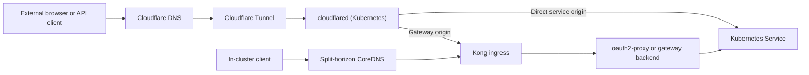

# Ingress and published-route overview

This is the **declared GitOps ingress inventory** for the active EliteBoxes Kubernetes cluster, based on the current Terraform `managed_apps` map. Public hostnames are represented only as a prefix; append `.<domain>` to form a complete hostname. No private domain name or public IP address belongs in this repository.

> **Authoritative boundaries:** `automation/infra-as-code/terraform/deployments/tunnel.tf` declares managed Cloudflare Tunnel hosts and their Kubernetes origins. `platform/observability/monitoring/gatus/gatus-configmap-config.yaml` defines probes. `workloads/apps/homepage/homepage-configmap.yaml` defines the navigation dashboard. The architecture classification is specified by `docs/repository-layout.md`; CI checks consistency between these representations.

## Request paths

The Cloudflare Tunnel maps most managed hosts **directly** to the Kubernetes Service. The Gatus and Longhorn user interfaces use **Kong → oauth2-proxy**; the LLM and MCP gateway hosts use **Kong and gateway-specific authentication**. For internal service-to-service traffic, split-horizon DNS may resolve a public-format hostname to Kong without traversing the public Cloudflare route.

Terraform is executed through **Semaphore UI**; it does not own the Kubernetes Ingress YAML. Flux/Argo CD still manage the in-cluster resources and routes. The tunnel is a single shared Cloudflare configuration resource: never infer that adding a new `managed_apps` entry is permission to remove or replace any pre-existing live rule.

## Architecture groups

| Gatus group | Repository responsibility | Routes |
|---|---|---:|
| `00-edge` | Public DNS/certificate synthetic checks, not a separately owned hostname | 0 |
| `10-platform` | `platform/`: observability, monitoring, storage | 3 |
| `20-infra` | `infra/`: operations, GitOps control, secrets, automation | 5 |
| `30-services` | `services/`: identity and shared API gateway | 3 |
| `40-workloads` | `workloads/apps/`: end-user and application workloads | 11 |
| `50-compute-synology` | Synology-specific checks (disabled until publicly published) | 0 |

The declared public inventory comprises **22 hostnames**. Every row below has exactly one *primary* Gatus check and one Homepage link. The synthetic `cloudflare-domain` monitor separately rechecks `homepage` under `00-edge` for domain and certificate expiry.

## Declared public routes

The first column is the hostname **prefix**, not a complete address. The table's origin is the one declared for *new/missing* managed routes; it does not assert that an already-existing live Cloudflare rule currently points to the same origin.

| Public host prefix | Architecture group | Declared Cloudflare origin | Primary Gatus endpoint |
|---|---|---|---|
| `gatus` | `10-platform` | `http://kong-kong-proxy.kong.svc.cluster.local:80` | `gatus` |
| `grafana` | `10-platform` | `http://grafana.observability.svc.cluster.local:3000` | `grafana-api-health` |
| `storage` | `10-platform` | `http://kong-kong-proxy.kong.svc.cluster.local:80` | `longhorn-ui` |
| `argocd` | `20-infra` | `http://argocd-server.argocd.svc.cluster.local:80` | `argocd-version` |
| `headlamp` | `20-infra` | `http://headlamp.headlamp.svc.cluster.local:80` | `headlamp` |
| `portainer` | `20-infra` | `https://portainer.portainer.svc.cluster.local:9443` | `portainer-status` |
| `semaphoreui` | `20-infra` | `http://semaphoreui.semaphoreui.svc.cluster.local:3000` | `semaphore-ui` |
| `vault` | `20-infra` | `http://vault.vault.svc.cluster.local:8200` | `vault-sys-health` |
| `auth` | `30-services` | `http://authentik-server.identity.svc.cluster.local:9000` | `authentik` |
| `llm-gw` | `30-services` | `https://kong-kong-proxy.kong.svc.cluster.local` | `llm-gateway` |
| `mcp-gw` | `30-services` | `https://kong-kong-proxy.kong.svc.cluster.local` | `mcp-gateway` |
| `bookmarks` | `40-workloads` | `http://linkding.linkding.svc.cluster.local:9090` | `linkding` |
| `fm-dev` | `40-workloads` | `http://fm-webui.firewall-manager-dev.svc.cluster.local` | `firewall-manager-dev` |
| `fm-prod` | `40-workloads` | `http://fm-webui.firewall-manager-prod.svc.cluster.local` | `firewall-manager-prod` |
| `fm-staging` | `40-workloads` | `http://fm-webui.firewall-manager-staging.svc.cluster.local` | `firewall-manager-staging` |
| `forgejo` | `40-workloads` | `http://forgejo.forgejo.svc.cluster.local:3000` | `forgejo` |
| `homebox` | `40-workloads` | `http://homebox.homebox.svc.cluster.local:80` | `homebox` |
| `homepage` | `40-workloads` | `http://homepage.homepage.svc.cluster.local:80` | `homepage` |
| `n8n` | `40-workloads` | `http://n8n.n8n.svc.cluster.local` | `n8n` |
| `openwebui` | `40-workloads` | `http://openwebui.ai.svc.cluster.local:8080` | `openwebui` |
| `stargate` | `40-workloads` | `http://vaultwarden.vaultwarden.svc.cluster.local:80` | `vaultwarden` |
| `termix` | `40-workloads` | `http://termix.termix.svc.cluster.local:3000` | `termix` |

**Origin transport / access considerations:** `portainer`, `llm-gw`, and `mcp-gw` currently declare `no_tls_verify = true` for their HTTPS origin connection; review origin certificate validation separately before tightening this. The LLM `/v1/models` probe **expects HTTP 401** without a key, proving API-key protection is active, rather than treating an authenticated API as a public website. Cloudflare Access rules and application authentication are independent of route publication.

## Kong and internal-only ingress

| Host prefix | In-cluster route | Destination or protection | GitOps owner |
|---|---|---|---|
| `gatus` | `/` and `/health` | Kong → monitoring oauth2-proxy → Gatus; `/health` skips OAuth | `platform/observability/monitoring/gatus/oauth2-proxy/` |
| `storage` | `/` and `/ping` | Kong → Longhorn oauth2-proxy; `/ping` is a public monitor endpoint | `platform/storage/longhorn/oauth2-proxy/` |
| `llm-gw` | `/v1/*`, `/openai/*` | Kong AI/auth plugins; protected model discovery and completion routes | `services/gateway/kong/llm-gateway/` |
| `mcp-gw` | `/healthz`, `/kubernetes`, `/nmap` | Static health and API-key/ACL-protected MCP routes | `services/gateway/kong/mcp-gateway/` |
| `auth` | `/` | Split-horizon in-cluster Kong routing to Authentik; external tunnel goes directly to Authentik | `services/identity/kong-ingress/` |
| `api-gw` | `/healthz`, `/mikrotik/*` | **Internal-only** Kong host; RouterOS REST access is key-authenticated | `services/gateway/kong/api-gateway/` |

The three Gatus WireGuard peer checks target `api-gw` through the internal Kong path. They use `30-services`, are not part of the Cloudflare public route count, and must not be added to Terraform just to make a public-URL coverage check pass.

Other Kubernetes Ingress rules such as `homebox`, `homepage`, `openwebui`, `termix`, and `stargate` support **in-cluster Kong resolution** while their declared **external** Cloudflare routes point straight to their Services. These two paths are deliberately not interchangeable.

## Out-of-scope or unverified entries

- **Pi-hole:** Homepage retains its existing `pihole` navigation link in the explicit **Unmanaged / verify** group. This host is not declared in `managed_apps` and has no Gatus public-route check. Its live DNS/ingress state needs independent verification before treating it as publicly exposed. Do not automatically publish an administrative DNS UI.
- **Synology GitLab:** the `gitlab-synology` Gatus check remains **disabled**; there is no managed `gitlab` tunnel rule. Synology is outside the active EliteBoxes Flux root.
- **Firewall Manager:** public `fm-dev`, `fm-staging` and `fm-prod` hosts point directly to their `fm-webui` Services. Separately, the Argo CD environment overlays still declare `fm-*.local` with IngressClass `public` and nginx annotations. This is **not** the declared public Cloudflare route. Do not switch these Ingress classes/hosts without checking the live ingress controller, DNS and Argo CD ApplicationSet.
- **Existing Cloudflare rules:** `existing_ingress` deliberately retains pre-existing/hand-created hostnames and origins. Therefore the declared inventory **cannot prove** there are no stale rules, duplicates, incorrect origins, or additional exposed hosts live. The CI test is a Git-only contract, not a live Cloudflare audit.
- **DNS ownership:** not every host in `managed_apps` has its DNS record created by Terraform. `dns_missing_apps` and the separate Gatus record cover only specific entries; other DNS records may still be dashboard-managed. Avoid importing or destroying existing records incidentally.

## Checks before approving or applying

1. CI: `python3 scripts/validate-public-routes.py` checks every declared public host against its Gatus group, Homepage category and the exact origin and primary endpoint in this table.
2. Render/validate Flux manifests with the repository's existing `kustomize-render` workflow. A group-only Gatus change should not replace its HelmRelease, PVC, Service or OAuth proxy.
3. In Semaphore UI, review a **Terraform plan only** and stop if Cloudflare proposes unexpected changes to tunnel ingress order, origins, Access applications/policies or DNS records. This PR adds only unused `group` metadata to Terraform's local map; it is **not** an authorization to apply unrelated drift.
4. After merge and Flux reconciliation, confirm Gatus displays the `00-edge`, `10-platform`, `20-infra`, `30-services`, `40-workloads` groups, and Homepage navigation matches. Changing a Gatus endpoint's group changes its logical monitoring identity; older SQLite history for the previous group may remain under the old identity even though the PVC is preserved.
5. For a **live** audit, compare Cloudflare's ordered tunnel ingress rules and DNS records with this table, and compare actual `kubectl get ingress -A` and `kubectl get svc -A` output. Do not paste unredacted hostnames, IPs or logs into GitHub.

These steps validate declared state safely. They do not claim to have probed live endpoints, credentials, TLS, or live Cloudflare configuration.
